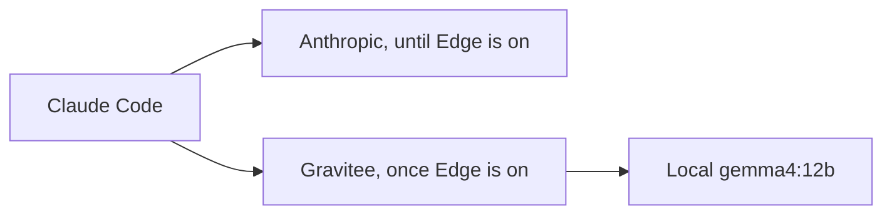

# AI Usage Governance — Claude Code

A developer uses Claude Code the way they already do. Edge sees that direct use. You turn interception on, and the next prompt comes through Gravitee.

The pass takes about 15 minutes. Nothing here is a slide.

The daemon is installed on this Mac from Gamma, **Edge Management**, **Daemon deployment**, and it is already running. Shadow AI watches `api.anthropic.com`. Interception does not, yet: **DNS domains** is `unused.invalid`, a name nothing calls. Leave `ANTHROPIC_BASE_URL` unset.

This demo does not show Windows, Linux, Microsoft Entra, browser traffic, or Microsoft Copilot. The daemon is macOS only.

## 1. Use Claude Code without a care

1. Start Claude Code and sign in with `/login` if it is not already signed in.
2. Send: `The checkout client gives up when the payment API times out. Can you add a retry with backoff?`

Claude Code talks to Anthropic. Gravitee is not on that path.

## 2. Show the shadow AI usage

1. In Gamma, open **Edge Management**.
2. Wait until the device reports a direct connection to `api.anthropic.com`. That can take about two minutes.
3. Show that row. It is the developer using Claude on their own. The row does not contain the prompt.

## 3. Turn Edge on

1. On the same page, under **DNS domains (interception mode)**, replace `unused.invalid` with `api.anthropic.com`.
2. Save. The routes are already there: `/v1/messages` goes to `/interception/claude`, and every other Anthropic call goes to `/interception/passthrough`. The daemon polls about every 15 seconds and applies the change.
3. Send a follow-up: `Also log each retry, including how long the payment API took.`

That prompt comes through Gravitee. On [Governed models](http://localhost:8086/environments/default/aim/llm-proxy/a1c0de00-0000-4000-8000-000000000002), the flow **Govern messages** has run: prompt guard rails, PII filtering, routing to local `gemma4:12b`, and the token limit. The answer comes from Gemma. If Gemma fails, failover retries the same route on local `qwen3:1.7b`. The log names the outcome. Headers are not stored. The payload is stored. The first answer can take a few seconds while Ollama loads the model.

## Put the demo back

On this playground's page, choose **Re-seed**. That puts **DNS domains** back to `unused.invalid`, so the next pass starts with Claude Code talking to Anthropic again. Shadow AI still watches `api.anthropic.com`. It also republishes the LLM proxy, with local Gemma as the default route, Qwen as its failover, and the Anthropic endpoint configured.

Do not use **Reset** on the Containers page. That removes the whole lab, including other demos.
