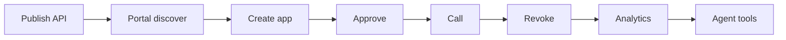

# API Self-Service & Credential Lifecycle

One developer calls one shared REST API with an API key. The service owner approves that key. After that, an approved agent calls the same API as tools. You publish nothing by hand: the seed already published **Shared Services API**, **Shared Services API 2.0**, **Platform Notices API**, and **Shared Services tools** into the DEFAULT environment. Shared Services API carries an API Key plan and an Access token plan. You create **Consumer App A** in the Developer Portal, approve it, call the API, then revoke that key. The agent beat comes after that.

Three built-in users carry the pass. [Platform administrator](account:admin) opens the platform. [Developer](account:user) requests access. [Service owner](account:api1) approves and revokes the key. Gravitee already has these users.

Lessons 1 to 8 take about 22 minutes. The whole pass, including putting the lab back, fits in 25 minutes.

Revoke stops an existing key. That is the deny you show in lesson 6. Renew issues another key, and the previous key can remain valid until it is revoked or it expires. Expiration is a validity end. This demo leaves keys without an expiry, and it does not renew a key.

## 1. Show the secured API

Open the [Gamma console](http://localhost:8086) and sign in as [admin](account:admin) when the console asks.

1. In the left navigation, open **APIs**.
2. Open **Shared Services API**.
3. Open **Plans**. Show the plan named **API Key**. Subscription validation is manual: a request waits until the service owner approves it, and the platform then issues the key. The other plan is **Access token**. Short-lived tokens, after lesson 8, shows that plan.
4. Open **Policies** and select the **API Key** plan. Show the flow named **Subscriber controls**. The request step is the shared policy group of that name. An accepted response carries `X-Shared-Services: accepted`.
5. The gateway context path is `/shared-services`. Calls from this machine use `http://localhost:8082`.

Open [Call stage](http://localhost:8155). The calls are tabs. Choose one, then press **Call**.

1. Choose **Backend** and press **Call**. The request goes straight to the API. The status is 200, and the list includes `service-001`.
2. Choose **No key** and press **Call**. Gravitee answers and the API does not. The status is 401 or 403.

## Same controls, and version 2.0

Version 1.0 stays published on `/shared-services`. Version 2.0 is the next contract of the same catalog, published beside it. Gravitee keeps each version as its own API, with its own context path.

1. In the [Gamma console](http://localhost:8086), open **Settings**, then **Gateway**, then **Shared policy groups**. Open **Subscriber controls**. A subscribed application may read only: GET, HEAD and OPTIONS. It may make 60 calls a minute and 5000 calls a day. Deploying a change here reaches every API that uses the group on the next call.
2. Open **Shared Services API**. Its version is 1.0. Open **Policies**, the **API Key** plan, and the flow **Subscriber controls**. The request step is that group.
3. Open **Shared Services API 2.0**. Its version is 2.0. The context path is `/shared-services-v2`. The plan uses the same group. A service in this version includes `channel`. `service-001` has channel `reports`.
4. Open **Platform Notices API**. This is a different API. The context path is `/platform-notices`. The plan uses the same group. An accepted response carries `X-Platform-Notices: accepted`.

## 2. Discover the API in the Developer Portal

Open the [Developer Portal](http://localhost:8085/next/) and sign in as [Developer](account:user). Developer is the platform's built-in user `user`.

1. Open the catalog.
2. Open **Shared Services API**.
3. Open its OpenAPI documentation. Show `GET /v1/services`, `GET /v1/services/{id}`, and `GET /v1/health`, including the example for `service-001`. The page uses Try it out. A call from it needs the key from lesson 4, so leave the button until then.
4. Open **Access** and show **Request access**.
5. Show the **API Key** plan on that API. The subscription request comes in the next lesson.

The portal you are looking at is the DEFAULT environment's Developer Portal, the same portal other demos on this Lab can publish into.

## 3. Create Consumer App A and request access

Consumer App A is not in the seed. Create it now, and name it exactly `Consumer App A`.

1. In the portal, open **Applications**.
2. Create an application and set its name to `Consumer App A`.
3. Return to **Shared Services API** in the catalog.
4. Subscribe that application to the **API Key** plan. The control sits on the API page. Choose Consumer App A and the API Key plan.

The plan uses manual approval, so the subscription stays pending. Stop here and switch to the console for the approval. Leave the key field empty: the platform generates the key when you approve.

## 4. Approve the subscription

Sign out of the platform administrator. In the [Gamma console](http://localhost:8086), sign in as [Service owner](account:api1). Open **Shared Services API**.

1. Open **Consumers**. A 4.13 console uses that label for the subscription list. The same list is where you look when a console labels it Subscriptions.
2. Select the pending subscription for **Consumer App A**.
3. Accept it. The accept control is on that subscription.
4. Open the subscription's API keys and copy the key the platform generated.

That key belongs to Consumer App A.

Say this while the subscription is open. The service owner runs this API and is the person who approves a consumer. Another team owns its own API. This sign-in is refused that API. The platform administrator can open every API, and is not the person who approves Consumer App A.

## 5. Call the API

Open [Call stage](http://localhost:8155). The calls are tabs. A tab that needs a key opens an authorization panel between the tabs and the diagram. Choose a call, then press **Call**. Nothing is drawn until then. **Slow draw** walks the boxes, and each arrow draws itself as the call moves. The request and the response appear beside the arrow while it travels, then close. Clear **Slow draw** to show the finished diagram at once. Click a box to read the request and the response. Click a Gravitee box to read the log API Management kept for that call: the plan, the application, and the gateway’s own reason. It appears a few seconds after the call. **History**, on the left edge, opens the calls made on this page. Choose one to put that result back in the diagram, and the list closes. A refresh clears it. **Network**, along the bottom, opens the timeline. Select a row to read that call.

1. Choose **No key** and press **Call**. Gravitee answers and the API does not, so the diagram stops at Gravitee and the response comes back. The status is 401 or 403.
2. Choose **With a key**. Paste Consumer App A's key into the authorization panel, then press **Call**. The status is 200. The response includes `X-Rate-Limit-Remaining`, `X-Quota-Remaining`, and `X-Shared-Services: accepted`. The list includes `service-001`.
3. Return to the OpenAPI page in the [Developer Portal](http://localhost:8085/next/). Choose **Authorize**, select the API key, paste the same key, and confirm. The page also lists OAuth2. Short-lived tokens, after lesson 8, is the call that uses that token. Open `GET /v1/services`, choose **Try it out**, then **Execute**. The status is 200 and the list includes `service-001`. The browser calls the gateway. The portal origin is allowed, and the key travels in `X-Gravitee-Api-Key`.

What the audience should see:

- Consumer App A's valid key returns 200, and the list includes `service-001`.
- A call with no key is rejected, with 401 or 403, whichever this gateway returns.

## 6. Revoke the key

Stay signed in as [Service owner](account:api1). In the [Gamma console](http://localhost:8086), open **Shared Services API**, then **Consumers**, then Consumer App A's subscription. In its API keys, use **Revoke** on the key you just called with. Revoke stops that key. This is the live deny.

On [Call stage](http://localhost:8155), choose **With a key** and press **Call** again. The gateway rejects it, with 401 or 403.

Say what you did, and what you left alone:

- Revoke stops an existing key. Consumer App A's key no longer opens the API.
- Renew issues another key. It is a separate operation from revoke. The previous key can remain valid until you revoke it or until it expires.
- Expiration is the time a key stops being valid on its own. This demo leaves the keys without an expiry.

## 7. Show consumption

Stay signed in as [Service owner](account:api1). In the [Gamma console](http://localhost:8086), open **Shared Services API**, then **Analytics**. Filter by **Consumer App A**. The **Consumers** list is the other place that shows that subscription.

Analytics can take a short time to appear after the calls. Refresh once if the charts are still empty. The rejected calls and the successful calls are both traffic on this API.

## 8. Let an agent call the API as tools

The seed published **Shared Services tools** at `http://localhost:8082/shared-services-tools/`. The agent speaks MCP to that address. Gravitee checks the agent, applies the policies, and calls Shared Services. The agent is not given the API address.

Stay signed in as [Service owner](account:api1). In the [Gamma console](http://localhost:8086), open **APIs**, then **Shared Services tools**.

1. Open the tools. The endpoint grants **listServices** and **getService**. **getHealth** is on the API and is not a tool.
2. Open **Policies** and show the flow named **Guardrails**. It applies to a tool call: 30 calls a minute, 500 calls a day, and a 32 KB request limit. An accepted tool call carries `X-Shared-Services: accepted`.
3. Open the plan named **Agent**. It is an API key plan. **Audit agent** is subscribed to it. Copy the key from **Details**, under **Audit agent: API key**.

Open [MCPJam Inspector](http://localhost:6274/#token=gravitee-lab-local-inspector). The link carries the key that signs your browser in. The first time, a dialog offers a server URL. Click **Set up later**.

1. Open **Connect**, then **Add Server**.
2. Name it `shared-services`. Leave the connection type on **HTTP**. Set the URL to `http://apim-gateway:8082/shared-services-tools/`.
3. Open **Connection overrides** and add a header. The name is `X-Gravitee-Api-Key`. The value is the Audit agent key. Click **Add Server**.
4. Under **Inspect**, open **Tools**. The list is listServices and getService. getHealth is not there.
5. Open **listServices** and run it. The answer includes `service-001`. Gravitee called the API.

That key is for the tool endpoint. It is not a key for the REST API.

## Short-lived tokens

Open the [AM Console](http://localhost:8081) and sign in with the AM Console account from **Details**. That password is the Access Management one.

1. Open the domain **Shared Services**.
2. Open the application **Shared Services caller**.
3. Show the access token lifetime. It is 120 seconds. The scope is `shared-services`.

Stay signed in as [Service owner](account:api1). In the [Gamma console](http://localhost:8086), open **APIs**, then **Shared Services API**.

1. Open **Resources**. **shared-services-am** is a Gravitee Access Management authorization server. The gateway asks that server whether the token is still valid.
2. Open **Plans** and select **Access token**. The security is OAuth2. The plan requires the scope `shared-services`. The flow is the same shared policy group as the API key plan. **Shared Services caller** is subscribed to this plan.

Open [Call Stage](http://localhost:8155).

1. Choose **With a token**. The page asks Access Management for a token and sends it. The status is 200. The response includes `X-Shared-Services: accepted` and `service-001`.
2. Say this. The API key stays valid until the service owner revokes it. This token lasts two minutes. After that, Access Management reports it inactive and the gateway refuses the same call. A new token is accepted. The key plan and the token plan sit on the same API.

## Start again

1. In the [Gamma console](http://localhost:8086), open **Applications**, open **Consumer App A**, and close its subscription.
2. Delete **Consumer App A**.
3. Re-seed this playground in the Lab UI.

Re-seed republishes Shared Services API, Shared Services API 2.0, Platform Notices API, the subscriber controls, the Access token plan, the tool endpoint, and this demo's portal content into DEFAULT. Audit agent, Shared Services gateway, and Shared Services caller stay. The APIs stay. Consumer App A is absent.

Another playground that publishes into this same DEFAULT environment replaces this portal content when it is seeded.

## If something does not work

- **The API is missing.** Start the playground, or re-seed it. The seed is done when `api-self-service-lifecycle-seed` has exited successfully.
- **The subscription stays pending.** The API Key plan waits for approval. Sign in as the service owner, open Shared Services API, then **Consumers**, and accept Consumer App A's subscription.
- **A valid key returns 401 or 403.** Use the key from the subscription you accepted. A revoked Consumer App A key is supposed to be rejected.
- **The portal shows a different demo.** This playground publishes into the DEFAULT Developer Portal. Re-seed this playground for Shared Services API. Seeding another playground into this same environment puts that playground's portal content in its place.
- **The gateway has no API on `/shared-services`.** The seed publishes that context path. Re-seed, then call `http://localhost:8082/shared-services/v1/services`.
- **The health tool is in the list.** Re-seed. The tool endpoint grants list and get only.
- **MCPJam Inspector says Open MCPJam from your terminal.** Open it from [its link](http://localhost:6274/#token=gravitee-lab-local-inspector). The link carries the key that signs the browser in.
- **The server does not connect.** The URL is `http://apim-gateway:8082/shared-services-tools/`, from inside the inspector, and the header is the Audit agent key. Without that header the endpoint rejects the session.
