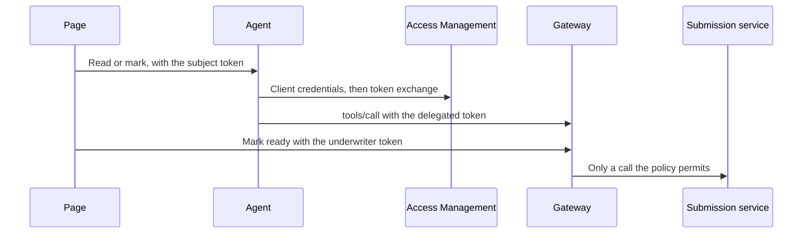

# Specialty underwriting delegated review

A signed-in underwriter asks a hosted agent to read one synthetic cyber submission. The agent has its own client, exchanges a delegated access token, and can read the submission. The same agent cannot mark it ready for quote. The underwriter can. The gateway's decision is the evidence.

The record is fixture data. Marking it ready does not quote, bind, or issue coverage. The issuer of every token is this lab's Access Management domain. Nothing here is a customer submission.

Sign in as [Casey Hale](account:casey.hale@specialty-underwriting.test). The underwriting desk is http://localhost:8170. The cyber review agent sits on the file with the underwriter. Gamma is http://localhost:8086. Access Management is http://localhost:8081, in its own window.

Before the clock, open http://localhost:8170/api/ready and confirm it says the agent and the submission service are up. Leave the submission at `IN_REVIEW`.

## 1. Read the submission through the agent

On the desk, [sign in](action:sign-in), then [read the context through the agent](action:read-through-agent). The agent is the colleague on the file. The underwriter is the other.

The page shows `CYB-001`, line `CYBER`, status `IN_REVIEW`, and the exchange it actually received: `iss`, the underwriter's `sub`, and `act.sub` of `cyber-review-agent`. Those two subjects are different. The write handler count stays 0.

The agent is the Access Management application **Cyber review agent**. The domain issues the underwriter token and the delegated token. The agent does not reuse the underwriter token on the gateway.

## 2. The agent cannot mark it ready

[Mark ready through the agent](action:mark-through-agent).

The gateway answers the same tool, `mark_ready_for_quote`, with a refusal. The page shows the HTTP status, the MCP error, and a correlation id. The status stays `IN_REVIEW` and the write handler count stays 0: the private service did not take the write.

The rule is **Delegated agent cannot mark a submission ready** on the MCP proxy **Specialty underwriting submissions**, in the tool-call flow. Both tools stay listed. The denial is not a hidden tool.

## 3. Mark it ready yourself

[Mark ready myself](action:mark-myself).

This is the same tool and the same record, with Casey's own access token and no actor. The status becomes `READY_FOR_QUOTE`. The write handler count increases by one. That status is a sandbox label. It does not bind coverage.

## 4. Open the denied decision

In Gamma, open Authorization, then Decisions. Match the correlation id from step 2 and open **Reasons**.

The reason names **Delegated agent cannot mark a submission ready**. The decision view shows no bearer token and no tool payload. Gateway logging for this proxy records the call without headers or payloads.

The page also sends that Gamma address to the Lab UI when a call carries a correlation id.

## Start again

On the desk, [reset the demo](action:reset-demo). The submission returns to `IN_REVIEW` and the write count returns to 0. Sign in again: the access token lasts 10 minutes, and reset drops the page session.

Re-seed puts the domain, the agent, the proxy, and both policies back as the files say. It does not clear platform logs, and it does not remove a Gamma link that already points at another working domain.

## Offstage checks

These are outside the four minutes.

- Sign in as [Jordan Clerk](account:jordan.clerk@specialty-underwriting.test) and mark ready yourself. Jordan is not in **cyber-underwriters**. The gateway refuses the call and the status does not change.
- An expired underwriter token is refused by the page before it calls the gateway. An expired or widened delegated token is refused by the agent before it calls the gateway. Neither path retries with the raw underwriter token.
- The sponsor line on the record is demo metadata. The policies do not read it.

## If something does not work

`/api/ready` names which of the agent or the submission service is down. A failed exchange says it stopped before the gateway, and the write count stays where it was. If Gamma is linked to another domain, Agent Identity for this domain is not listed there until that link is this domain; the seed leaves a working link to another domain as it is. If the decision page is not the one the link opened, use the correlation id in Decisions and do not treat the link itself as the proof.
